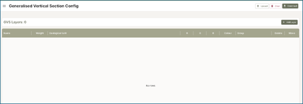
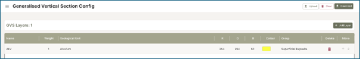
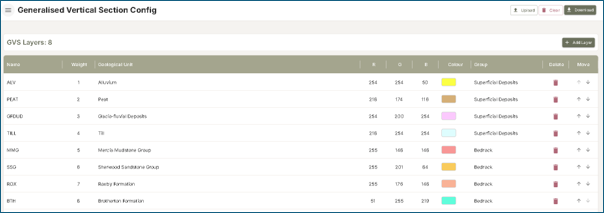
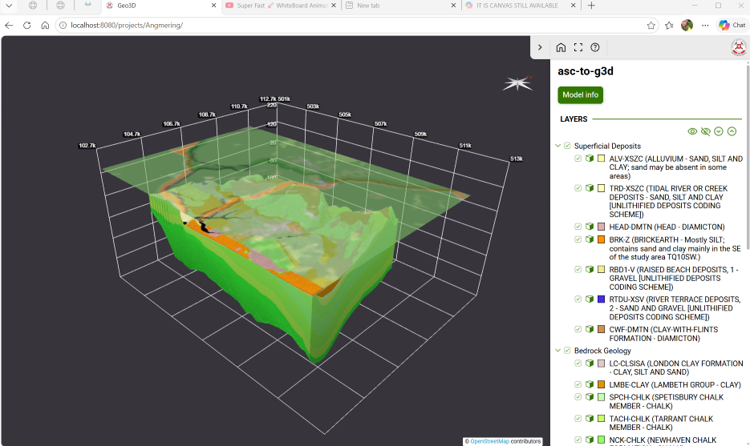
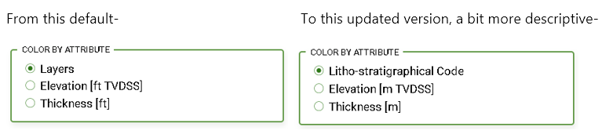

# Step by Step Guide - Geo3D Loader

## Introduction
This chapter is a step-by-step guide to creating the required files for viewing models in the Geo3D Viewer software. It should be read in combination with other chapters describing the GVS Configuration, Model Conversion, and Project Configuration.

## Step 1 – Creating a legend file

This first step will create a legend file that provides information (name, colour, description) for each of the geological units to be displayed in the final model. Often these types of legends are created by most modelling software so this information may already exist alongside your 3D model.

The legend is created using the “GVS Config” tool under the main menu on the Geo3D Project Configurator form here: http://geo3d-project-config-52d7a1.glpages.ad.nerc.ac.uk

Click the “Add Layer” button to create a new model layer, give it a name (this must match the name of ascii grid file it refers to), adjust the colour value (Red, Green and Blue), and assign it to a group (such as superficial, bedrock or the grouping depending on the model specification).

Continue to add the layers until the GVS entries match the geological units to be displayed in the final model.

Click the “download” button to save as “layer_config.txt”.

## Step 2 – Converting ASCII grids

For any geological model to be visualised in the Ge03D Viewer the model units need to be converted to .g3d format. BGS have developed a converter which does this, whilst simultaneously building the basics of the next step – the project.json file. The project.json file tells the Viewer software how to display the geological model. The final step in this instruction document discusses customising the project.json such as adding a title, description and various other features so that the user receives a better experience.

### Layer Names and Suffixes

It is important to note that the asc-to-g3d tool requires two ASCII grid files per layer to generate the g3d file, these can be: top & base, top & thickness, or base & thickness. The suffix used by each file will be important to determine what it represents. If files with all three suffixes are provided, the asc-to-g3d tool will select which two to use.

Example 
- MY-LAYER_T.asc The \_T means it represents the "top"
- MY-LAYER_B.asc The \_B means it represents the "base"
- MY-LAYER_TH.asc The \_TH means it represents the "thickness"

The exact suffixes to be used can be configured when using the asc-to-g3d tool, the defaults are those shown in the above example.
The root part of the file name e.g. MY-LAYER must be consistent for related ASCII files, the root name will also be used to name the G3D file e.g. MY-LAYER.g3d, the name in the GVC configuration file must also match, again in this example it would be MY-LAYER.

#### Using batch and single conversion mode

For batch mode conversions see below.

&lt;name of exe above including folder location&gt;.exe **batch** -v -d &lt;directory path containing ascii grids&gt; -c &lt;GVS config file path&gt;

**Options**

- \--dir -d DIRECTORY Directory containing input files \[required\]
- \--suffix-top TEXT Optional suffix identifying 'top' files \[default: T\]
- \--suffix-base TEXT Optional suffix identifying 'base' files \[default: B\]
- \--suffix-thick TEXT Optional suffix identifying 'thickness' files \[default: TH\]
- \--suffix-out TEXT Optional suffix for output files \[default: .g3d\]
- \--out-dir -o PATH Optional output directory. Defaults to source dir.
- \--strict -s Strict mode
- \--zero -z FLOAT Thickness zero threshold \[default: 1e-05\]
- \--verbose -v Verbose mode
- \--layer-config -c PATH Path to an optional 'layer' CSV configuration file
- \--help Show this message and exit.

There is also a "**single**" mode, where specific named files can be targeted to create a G3D file

&lt;name of exe above including folder location&gt;.exe **single** -v -top &lt;file path containing top ascii grid&gt; - -base &lt;file path containing base ascii grid&gt; -c &lt;GVS config file path&gt; -o &lt;file path TO OUTPUT g3d file&gt;

**Options**

- \--output -o PATH Path to the generated output g3d file \[required\]
- \--file-top -top PATH Path to the 'top' input file
- \--file-base -base PATH Path to the 'base' input file
- \--file-thick -thick PATH Path to the 'thickness' input file
- \--strict -s Strict mode
- \--zero -z FLOAT Thickness zero threshold \[default: 1e-05\]
- \--verbose -v Verbose mode
- \--layer-config -c PATH Path to an optional 'layer' CSV configuration file
- \--help Show this message and exit.

### Using the asc-to-g3d tool

Navigate to this location in a web browser https://kwvmxgit.ad.nerc.ac.uk/geo3d-viewer/asc-to-g3d and double-click the “executables” folder. Download the latest version of the “asc-to-g3d….” file (select the file and then click “Download”).

Extract and save this to your computer.

Open “Command Prompt” (on a Windows PC search for “cmd”) and type: `name of exe above including folder location`.exe batch -v -d C:\Data\Projects\geo3d-viewer\161_Central_Glasgow_Superficial_Deposits_Block_Model\ASCII_grids_25m -c C:\Data\Projects\geo3d-viewer\161_Central_Glasgow_Superficial_Deposits_Block_Model\ASCII_grids_25m\layer_config.txt

Click enter and this will run the grid conversion to .g3d format and will also create a .json file.

Once the grids are converted to .g3d format create a new folder called “assets” and move all the new .g3d grids into it. Move the .json file to sit alongside the assets folder just created and rename to “project.json”.

The assets folder plus the project.json can now be uploaded to the Geo3D Viewer location (see http://geo3d-loader-documentation-830d89.glpages.ad.nerc.ac.uk/docs/serving-data.html for more details for hosting data) and viewed within the software. Note that the project.json creates only a basic view of the model but should produce the correct colours for each geological unit, put the units in the correct order and group them as specified.

## Step 3 - Project Configuration
This document discusses the use of a webform to enhance the user’s experience of viewing the 3D geological models inside the Geo3D Viewer software. The features listed here all affect how the 3D model is visualised in the viewer so all should be assessed and reviewed before publishing. Some of the features are listed as “default” and so they don’t necessarily need altering if you are using a standard display in the model viewer. These are marked with an underlined title. The .json file can be adjusted at any point during this process however, so it can be done in iterative stages.

### Enhancing the project.json file
Use a browser and navigate to the Geo3D Project Configurator webform http://geo3d-project-config-52d7a1.glpages.ad.nerc.ac.uk

Click on “Upload Project Config”

Select the project.json file created in the previous step and wait for the file to upload. A confirmation message at the bottom of the screen should appear to confirm that the project.json has loaded correctly. If there are error messages, please see the final section of this documentation.

**Project Language:** By default this is set to “en” but if any other language is required then this will need amending. Language code uses the ISO 639-1 two-letter code (e.g., en, pl)

**Project Title:** By default, the grid converter sets the name to "asc-to-g3d". This should be changed to a model name which the user will understand. Add any other languages (using the two-letter code) and title if using multilingual projects.

**Project ID:** Add a numerical identifier for the project. This can be useful if building a larger store of models which you can refer to by number/ID.

**Project Description:** This should be a description which captures the details about the model, for example why the model was developed and for which customer; year of publication; information on the geology in the model; any details worth highlighting. This box supports html markdown including references to images held on the internet (useful to link to published model images, or company logos). Add any other languages (using the two-letter code) and description if using multilingual projects.

**Attributes:** By default, the entry is set to “Layers” styling which links to the geological units in the model. This displays the geological unit name and colour by default, but if you specifically want it to display the attribute name (for example “Litho-stratigraphical Code”) in the table of contents, then click the number 1 to drop down more menu options and change the Name, for example:

Add any other languages (using the two-letter code) and layer name if using multilingual projects.

**Display & Units:**  Default values are metric, alter if other values are required.

**Discrete Items:** By default there are no items listed here, but these can be set if any model layers have different attributes in addition to geological layers (for example colouring by aquifer/aquitard).

### Voxel Groups
All the information in this group (core; geometry origin, geometry size, geometry Z scale; rendering ambient occlusion, rendering border enabled; Data Handling), is generated when you run the grid converter (the .json file contains this information).

### Info Picker Options
The info picker tool displays attribute values and/or metadata at a clicked location on the model. Each configuration is referenced from a model layer and links an attribute to the content shown in the popup.
Core; Maps; Content – all default values work without further adjustment and gives the user an on-screen output of “X, Y, Elevation (TVDSS)”. Further work to provide more user output is planned for next version.

### Layers

**Layers:** This information is generated when creating the GVS and using the grid converter in the previous chapters. All colours and stratigraphic order should be applied, but should be checked before publishing the model. If you notice units are not in the correct order you can use the up/down arrows on the right-hand side of each unit to move them around.

### Global Config Section

**CRS:** By default this will display in the Polish grid reference so this value needs amending - in the UK the CRS should be set to 27700.

**Near plane:** This is the minimum distance from the camera at which objects are rendered. Objects closer than this distance are clipped and not visible. Recommended value is 100.

**Far plane:** This is the maximum distance from the camera at which objects are rendered. Objects beyond this distance are clipped and not visible. Recommended value is 150000.

Setting appropriate Near and Far Plane values ensures:
    - The entire model is visible.
    - Rendering performance is optimized.
    - Depth precision issues (such as flickering or z-fighting) are minimized.

**Line Threshold:** Defines the tolerance used to display or detect lines and edges in the 3D scene. Higher values may cause more edges to be shown or selected, while lower values provide more precise line rendering and selection. Recommended value is 10.

**Imperial Measurements:** Tick this checkbox if the viewer should use imperial rather than metric units.

**Antialiasing:** Improves visual quality.

**Constant camera target distance:** During panning operations this ensures the camera and the target stay at a fixed distance.

**One Side Material:** Tick this on for surfaces to be rendered single-sided — back faces are null. By default this is unticked which means surfaces are double-sided (visible from both sides), which is generally needed for geological surfaces where the 'inside' is meaningful.

**CONFIG: BOUNDING BOX SECTION**

**Bounding Box Minimum (lower-south-west):** This information is provided by default in the .json file generated by the grid converter.

**Bounding Box Maximum (upper-north-east):** This information is provided by default in the .json file generated by the grid converter.

**Slicing:** Remove duplicates and epsilon value.

### Global Features
**Splashscreen:** By default this is set to false, but this option allows the user to create a startup screen which loads before the model and can provide some user enhancement such as a brief description of the model, some instructions for navigating, or other similar useful information. The splashscreen includes a button for the user to click which says "I understand" ensuring that the user reads the splashscreen before continuing. The language code and description should be added.

**Info Panel:** By default this is set to false, but this option allows the user to create an info icon on the top menu bar, which displays additional text to the model information. An example might be a link to the company website, link to further metadata etc.

**Coordinate grid:** The default options may not be suitable for every model so this is worth investigating. The options (with some suggested defaults) here are:

- textSize       ¦¦ 11
- boundingOffset ¦¦ 20
- UnitX	       ¦¦ 500
- UnitY	       ¦¦ 500
- UnitZ	       ¦¦ 50
- showonStart	   ¦¦ True

Adjust these value particularly if the model is small scale where, for example, 500m is not a suitable grid line distance. The grid is set to visible on loading, but there is a button to turn this on and off within the Geo3D Viewer.

**Iso Lines:** Isolines can only be drawn on mesh surface layers (for projects composed of voxel-style (blocky) models isolines are not applicable). By default this option is set to false but when enabled, pressing CTRL+click on a surface draws an isoline at that elevation.

**Tooltips:** This is set to true by default.

**Multilingual:** By default this is set to false meaning that only "en" will be selected. If other languages are required then turn this to true, but ensure that the extra languages have been added throughout this form wherever titles, labels and descriptions are required.

**Camera Views:** By default this is set to true (i.e. camera views can be selected by the user). This can be switched off if different controlled camera views are required.

**Screenshot:** By default this is set to true, allowing the user to download a screenshot.

**Fullscreen:** By default this is set to true, giving the user a button to switch between full screen mode.

**Extra Logo:** By default set to false. This allows for an additional logo to be visible on the viewer screen in the top right corner alongside the standard PGI logo. Suggest that all models should have a link to the parent organisation.  
Settings need to be: 
Src ¦¦ link to image of logo online e.g. https://www.bgs.ac.uk/wp-content/uploads/2020/03/BGS-logo-large.png 
Link ¦¦ link to web address

**Map Service:** By default this is set to Ordnance Survey’s “Outdoor Mapping” product, using a Web Map Service with 80% opacity.

**Driller:** By default this is set to true. This gives the user the option to drill a synthetic borehole through models.

**Dip Azimuth:** By default this is set to false but gives the user the option for measuring the dip and strike from surfaces (not gridded) models.

**Rose Diagram:** By default this is set to true giving the user orientation/compass in the top right of the screen. Untick if this is not required.

**Z Scale:** By default this is set to 1, but this option allows for the vertical exaggeration of the model objects to be changed in the viewer. An example is shown below of configuration options:

- min	    ¦¦ 1
- max	    ¦¦ 20
- default	¦¦ 10
- Step	    ¦¦ 1

**Cross Section X:** By default this is set to true, giving the user the option to draw a cross-section in the X axis. Configuration also allows any lines to be clipped (if polygons are used in the model) using the suggested value below.

    clipLines ¦¦ true

**Cross Section Y:** By default this is set to true, giving the user the option to draw a cross-section in the Y axis. Configuration also allows any lines to be clipped (if polygons are used in the model) using the suggested value below.

    clipLines ¦¦ true

**Cross Section Z:** By default this is set to true, giving the user the option to draw a cross-section in the Z axis. Configuration also allows any lines to be clipped (if polygons are used in the model) using the suggested value below.

    clipLines ¦¦ true

**Line Cross Section:** By default this is set to true, giving the user the option to draw free-form cross-section line anywhere in the model.

## Settings for Legacy Projects

The settings below are for legacy projects only. These can be ignored for new projects. 

_**Cross Section X (legacy):** This is an old setting to take into account the misspelling of crosssectX. Set by default as false._

_**Cross Section Y (legacy):** This is an old setting to take into account the misspelling of crosssectY. Set by default as false._

_**Cross Section Z (legacy):** This is an old setting to take into account the misspelling of crosssectZ. Set by default as false._

_**Line Cross Section (Legacy):** This is an old setting to take into account the misspelling in previous version. Set by default as false._